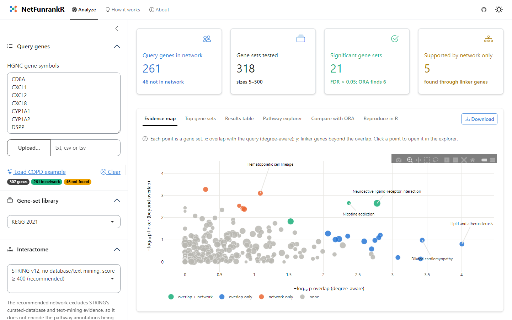

<!-- README.md is generated from README.Rmd. Please edit that file -->

# NetFunrankR 

**Decomposed, exact and calibrated network-proximity enrichment analysis of
gene lists**

NetFunrankR asks whether a gene list (disease genes, GWAS loci, DE genes) is
closer to each pathway in the human interactome than degree-matched random
genes, and tells you *where the evidence comes from*:

* **overlap** — query genes annotated to the pathway, tested with a
  degree-aware (Poisson-binomial) test that removes the hub bias of the
  hypergeometric ORA;
* **network (linker genes)** — query genes *not* annotated to the pathway
  that interact directly with its members, tested conditionally on the
  overlap.

The two tests are independent under the null and are combined with Fisher's
method. All null distributions are exact (discrete convolution; saddlepoint
approximation for long lists): no permutations, seconds per analysis.

The bundled STRING v12 interactome is rebuilt **without curated-database
and text-mining evidence**, so network proximity is not derived from the
pathway annotations being tested.

## Installation

```r
if (!requireNamespace("BiocManager", quietly = TRUE))
    install.packages("BiocManager")

# development version from GitHub (now)
BiocManager::install("Akmazad/NetFunrankR", dependencies = TRUE)

# Bioconductor release (after acceptance)
BiocManager::install("NetFunrankR")
```

`dependencies = TRUE` also installs the packages of the interactive
dashboard. Windows users building from GitHub need
[Rtools](https://cran.r-project.org/bin/windows/Rtools/).

## Quick start

```r
library(NetFunrankR)
net  <- stringNetwork()             # STRING v12, no database/text mining
kegg <- loadPathways("KEGG")        # also "Reactome", "WikiPathways"

res <- netEnrich(COPD_proteinCodingGenes, kegg, net)
res                                 # summary
table(evidenceClass(res))           # overlap only / network only / both
plotEvidenceMap(res)
plotLinkerNetwork(res, "Nicotine addiction", net)
```

Gene sets can also be a named list, a GMT file (`readGMT()`) or a
`GSEABase::GeneSetCollection`; any edge list can be used as network
(`buildNetwork()`); many gene lists can be tested in parallel with
`netEnrichBatch()`.

## Interactive dashboard

```r
runNetFunrankRApp()
```



Paste or upload genes, choose a library and interactome, then explore the
interactive evidence map, a searchable results table and linker networks;
download results, an HTML report and the R code that reproduces the analysis.
Computations run in background processes (via `mirai`), so the interface
stays responsive.

The dashboard works with any gene sets and interactome (any organism or
identifier type): `runNetFunrankRApp(geneSets = ..., networks = ...)`; start
from `dashboardDefaults()`. To host it for others (free options such as
Hugging Face Spaces, Posit Connect Cloud or shinyapps.io, or your own server
with Docker), follow [`deploy/README.md`](deploy/README.md).

## Documentation

* Vignette: `browseVignettes("NetFunrankR")`
* Benchmarks of the accompanying manuscript (type-I error, power under
  incomplete annotation, GSEABenchmarkeR, GWAS gene lists, robustness,
  runtime, COPD case study): `analysis/` in this repository,
  `bash analysis/run_all.sh`.

## Citation

`citation("NetFunrankR")`
